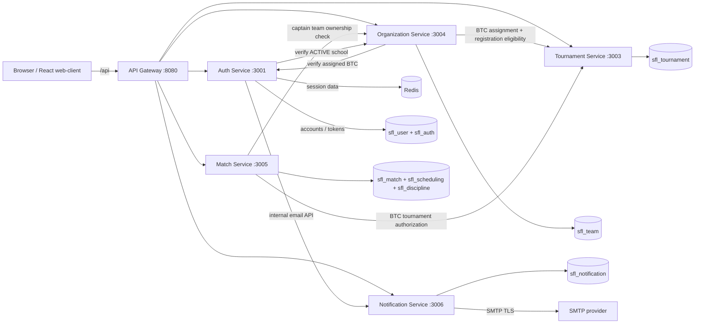
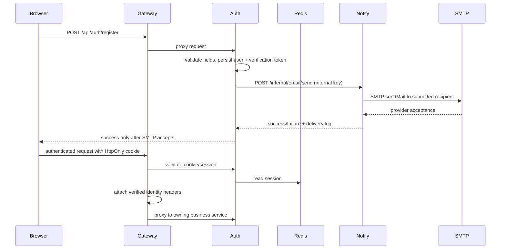
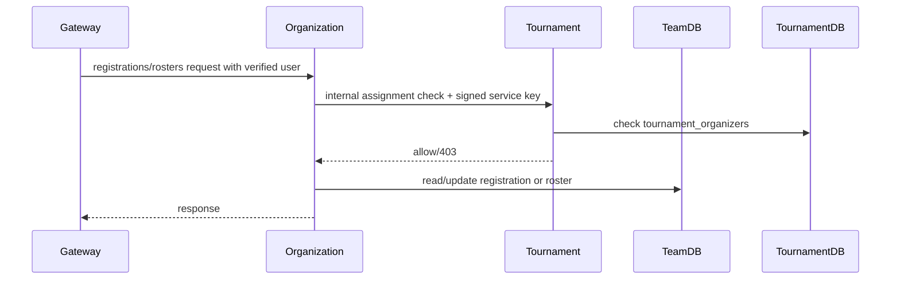

# Kiến trúc hệ thống SFTMS

> Tài liệu mô tả source hiện tại trong repo, không phải kiến trúc mục tiêu chưa triển khai. Cập nhật lần cuối: 05/11/2026.

## 1. Tổng quan

SFTMS là monorepo TypeScript cho hệ thống quản lý giải bóng đá sinh viên. Runtime có **5 backend services**; API Gateway, web client, PostgreSQL, Redis và các migration jobs là thành phần hỗ trợ, không phải backend service thứ sáu trở lên.



## 2. Cây thư mục chính

```text
.
├── apps/
│   ├── api-gateway/                 # Express edge router, session validation, proxy, CORS
│   │   └── src/{index.ts,config.ts,middleware/session.ts,middleware/cors.ts}
│   └── web-client/                  # React + Vite SPA, auth, role landing pages, business views
│       └── src/{App.tsx,api/,components/,App.css}
├── packages/
│   └── shared/                      # Role constants, shared public/auth DTOs, service names
├── services/
│   ├── auth-service/                # Auth + account/profile modules
│   │   └── src/{account/,controllers/,db/,lib/,middleware/,models/,repositories/,routes/,services/}
│   ├── organization-service/        # Institutions, teams, players, registrations, rosters
│   │   └── src/{controllers/,db/,lib/,middleware/,models/,repositories/,routes/,services/}
│   ├── tournament-service/          # Tournaments, rules, organizers, formats, seasons/draws
│   │   └── src/{controllers/,db/,lib/,middleware/,models/,repositories/,routes/,services/}
│   ├── match-service/               # Matches, results, standings, scheduling and discipline
│   │   └── src/{controllers/,db/,discipline/,lib/,middleware/,models/,repositories/,routes/,scheduling/,services/}
│   └── notification-service/        # In-app notifications and actual SMTP delivery
│       └── src/{controllers/,db/,lib/,middleware/,models/,repositories/,routes/,services/}
├── infrastructure/
│   └── postgres/init/               # Creates the service databases on a new Postgres volume
├── docs/                            # API routing, refactor map, audit, testing and use cases
├── docker-compose.yml               # Runtime, data stores, one-shot migration jobs, dev seed profile
├── pnpm-workspace.yaml
└── packages/shared/
```

**Code conventions:** each backend service keeps its own routes/controllers/services/repositories/models and database module. `src/index.ts` wires Express middleware and owned route modules. `src/db/migrate.ts` applies versioned schema changes. `packages/shared` contains cross-app types/constants; it does not own business data or repositories.

## 3. Năm service và ownership

| Backend service | Nhiệm vụ / nhóm chức năng | API chính qua Gateway | Dữ liệu sở hữu |
|---|---|---|---|
| **Auth** | Đăng ký VIEWER; phiên đăng nhập; hồ sơ, email verification, password reset; quản trị tài khoản; yêu cầu và quyết định cấp role | `/api/auth/**`, `/api/users/**` | `sfl_user`, `sfl_auth` |
| **Organization** | Trường; đội và đội trưởng; cầu thủ/membership; yêu cầu gia nhập đội và tạo CLB theo trường; danh sách đội dự giải; đăng ký và roster | `/api/institutions/**`, `/api/teams/**`, `/api/players/**`, `/api/player-requests/**`, `/api/club-requests/**`, `/api/registrations/**`, `/api/rosters/**` | `sfl_team` |
| **Tournament** | Giải; kỳ đăng ký; điều lệ/rules; institution được phép; phân công BTC; mùa giải, bảng đấu và bốc thăm | `/api/tournaments/**`, `/api/my/tournaments`, `/api/seasons/**`, `/api/regulations/**`, `/api/groups/**`, `/api/draws/**` | `sfl_tournament` |
| **Match** | Trận và kết quả; đội hình; sự kiện; biên bản; bảng xếp hạng; sân, thời gian, phân công trọng tài; thẻ, đình chỉ và khiếu nại | `/api/matches/**`, `/api/match-results/**`, `/api/lineups/**`, `/api/match-events/**`, `/api/match-reports/**`, `/api/schedules/**`, `/api/my/schedules`, `/api/venues/**`, `/api/cards/**`, `/api/suspensions/**`, `/api/complaints/**` | `sfl_match`, `sfl_scheduling`, `sfl_discipline` |
| **Notification** | Danh sách/thao tác thông báo trong ứng dụng; tạo nội dung email xác minh/reset; gửi SMTP; ghi trạng thái gửi | `/api/notifications/**`; internal `/internal/email/send` | `sfl_notification` |

### Trách nhiệm còn giữ ở Organization

`team_registrations` và `rosters` hiện vẫn thuộc `sfl_team` và Organization Service. Tournament Service lưu cấu hình giải và assignment BTC; không có database sharing. Organization gọi một internal HTTP endpoint của Tournament để xác nhận BTC có được giao giải trước khi đọc/duyệt registration hoặc thao tác roster theo giải. Đây là lời gọi đồng bộ có mục đích vì tổ chức đăng ký thuộc Organization nhưng assignment thuộc Tournament.

## 4. Database và quan hệ dữ liệu

PostgreSQL dùng một container development với database riêng cho mỗi miền dữ liệu. Tách database không đồng nghĩa đã tách cluster vật lý. Các ID tham chiếu giữa database/service là UUID nhưng không thể có foreign key xuyên database; service phải xác thực quan hệ qua API hoặc nghiệp vụ sở hữu.

| Database | Chủ sở hữu runtime | Bảng nghiệp vụ hiện có |
|---|---|---|
| `sfl_user` | Auth | `users` (including optional school assignment), `user_roles`, `password_resets`, `role_applications` (including school and application profile data), `account_profiles`, and the development-only `demo_account_registry` |
| `sfl_auth` | Auth | `email_verifications`, `refresh_tokens` |
| `sfl_team` | Organization | `institutions` (type, city, official website, address, source metadata, `DRAFT`/`ACTIVE`/`SUSPENDED` lifecycle), `institution_change_history`, `teams` (including short name), `players`, `player_requests`, `player_leave_requests`, `club_requests`, `team_registrations`, `rosters` |
| `sfl_tournament` | Tournament | `tournaments`, `registration_periods`, `tournament_allowed_institutions`, `tournament_rules`, `tournament_ranking_criteria`, `tournament_organizers`, `seasons`, `regulation_versions`, `groups`, `draws`, `regulations` |
| `sfl_match` | Match | `matches`, `match_results`, `lineups`, `match_events`, `match_reports`, `standings` |
| `sfl_scheduling` | Match | `venues`, `venue_availability`, `schedules` |
| `sfl_discipline` | Match | `cards`, `suspensions`, `complaints`, `disciplinary_decisions` |
| `sfl_notification` | Notification | `notifications`, `delivery_logs`, `email_delivery_logs` |

Mỗi database còn có `sfl_schema_migrations` để lưu version và thời điểm áp dụng. Quan hệ tiêu biểu:

- `users` 1—N `user_roles`; user ID được Auth cấp và được các service khác lưu như external identifier.
- `institutions` 1—N `teams`; `teams.captain_id` tham chiếu user ID do Auth sở hữu.
- `club_requests` lưu hồ sơ xin tạo CLB theo institution, người nộp, trạng thái xét duyệt và metadata thành viên ban đầu; khi duyệt, Organization tạo team trong cùng transaction.
- `teams` 1—N `players`; `players.user_id` là tài khoản cầu thủ tùy chọn. Unique partial index ngăn một user có nhiều membership chưa rời đội.
- `teams` N—N `tournaments` qua `team_registrations`; `rosters` lưu cầu thủ được đăng ký theo giải. Hai bảng này ở Organization DB.
- `tournaments` 1—N kỳ đăng ký/rules/versions/groups/draws; BTC N—N tournaments qua `tournament_organizers`.
- `matches` tham chiếu tournament/team UUID; `match_results`, lineups, events và reports tham chiếu match trong Match DB.
- `schedules` lưu tournament, match, venue và referee ID; đây là nơi xác định trận được giao cho referee.
- Thẻ/đình chỉ/khiếu nại/decisions do Match Service sở hữu trong `sfl_discipline`.
- Notification lưu thông báo theo user ID; SMTP attempt được ghi ở `email_delivery_logs`.

## 5. Giao tiếp giữa các thành phần

### Browser → Gateway → service

1. React gọi API tương đối dưới `/api`.
2. Gateway chọn backend theo path; không để frontend gọi từng service trực tiếp.
3. Với endpoint yêu cầu đăng nhập, Gateway gửi cookie đến Auth `/auth/session/validate`.
4. Gateway bỏ các `x-user-*` header do client tự gửi, rồi tạo lại user ID/email/roles, trường được gán và tên từ session đã xác minh.
5. Gateway gửi internal key và identity headers đến service; `x-user-name` được mã hóa base64url UTF-8 để an toàn với tên tiếng Việt trong HTTP header. Service xác minh internal key, giải mã tên và tiếp tục kiểm tra role/quyền sở hữu/scope.
6. API Gateway forward `Set-Cookie`; session cookie dùng `Path=/`, refresh cookie giới hạn `/api/auth`.

Các endpoint công khai như giải đấu, lịch, kết quả và bảng xếp hạng không đòi session; các API quản lý vẫn phải được bảo vệ ở service, không chỉ ở UI.

### Auth, session và token

- Mật khẩu lưu dạng bcrypt hash trong `sfl_user`.
- Access credential hiện tại là **opaque session ID trong cookie HttpOnly**, session payload được lưu trên Redis; đây không phải JWT access token.
- Refresh credential là opaque token, được lưu/rotate/revoke trong `sfl_auth`; refresh có hạn dài hơn session. Khi reset mật khẩu, Auth revoke refresh token và xóa session của user.
- Session lưu `userId`, email, roles, thời điểm tạo; role được xác thực lại ở Gateway qua Auth mỗi request, sau đó truyền đến backend.
- Email verification và password reset dùng token ngẫu nhiên một lần, có expiry; service lưu token state ở database Auth.
- Đăng ký công khai tạo VIEWER. `role_applications` lưu yêu cầu PLAYER/TEAM_CAPTAIN; ADMIN/BTC quyết định và việc cấp role được commit transactionally trong Auth. Sau khi được cấp role, người dùng cần đăng nhập lại để phiên mới nhận role.
- Người gửi có thể xem chi tiết mọi yêu cầu của mình; yêu cầu `PENDING` có thể được sửa hoặc hủy. Thao tác cập nhật/hủy xác minh chủ sở hữu và trạng thái trong transaction; hủy chuyển thành `WITHDRAWN`, giữ hồ sơ trong lịch sử và không xóa dữ liệu. Yêu cầu đã được xét duyệt không thể sửa/hủy.
- `GET /api/institutions` do Organization sở hữu và chỉ trả danh mục active ở TP.HCM. Dữ liệu demo nguồn chính thức hiện là danh mục đã xác minh từng bản ghi, chưa tuyên bố đầy đủ tất cả trường thành phố; chi tiết tài khoản/seed và giới hạn nằm trong [DEMO_ACCOUNTS_AND_TESTING.md](./docs/DEMO_ACCOUNTS_AND_TESTING.md).

### Internal service calls





Không dùng RabbitMQ trong runtime hiện tại; các nghiệp vụ cần kết quả ngay dùng REST. Redis chỉ phục vụ session. Notification API chưa phải message broker/queue.

## 6. API Gateway và frontend

Gateway lắng nghe `:8080`; frontend lắng nghe `:5173` ở host và proxy `/api/**` đến Gateway. Gateway định tuyến Auth/Users, Tournament, Organization, Match (bao gồm Scheduling/Discipline) và Notification theo path. Chi tiết từng route được liệt kê ở [docs/API_ROUTING.md](./docs/API_ROUTING.md).

Frontend là React SPA, dùng API client chung với credentials/cookie. Các trang đăng nhập/đăng ký, xác minh, quên/đặt lại mật khẩu, dữ liệu giải đấu, lịch, kết quả, standings, đội và trường nằm trong `apps/web-client/src`. Sau login, landing route theo role:

| Role | Route |
|---|---|
| ADMIN | `/admin` |
| BTC | `/btc` |
| TEAM_CAPTAIN | `/team` |
| PLAYER | `/player` |
| REFEREE | `/referee` |
| VIEWER | `/viewer` |

Các route dùng chung SPA và cùng nguồn dữ liệu API, nhưng dashboard/menu/quick links được chọn theo role; request đến API vẫn phải qua authorization ở backend. BTC dashboard tải `/my/tournaments`, Referee dashboard tải `/my/schedules`, Admin dashboard đọc tổng số tài khoản từ `/users`.

## 7. Vai trò và các guard đã triển khai

- Role hiện hành: `ADMIN`, `BTC`, `TEAM_CAPTAIN`, `PLAYER`, `REFEREE`, `VIEWER`; public registration chỉ tạo `VIEWER`. PLAYER/TEAM_CAPTAIN được cấp sau khi gửi role application và ADMIN/BTC duyệt.
- Admin quản lý tài khoản và phân công BTC theo trường qua `/users/**`; phân công BTC theo giải do Tournament quản lý.
- Chỉ ADMIN quản lý danh mục trường tại Organization. Trường mới ở trạng thái `DRAFT`; muốn kích hoạt cần có BTC được gán trường trong Auth. Danh mục đăng ký công khai chỉ trả trường TP.HCM đang ACTIVE và đã có BTC. Tạm khóa không xóa dữ liệu trường/đội/tài khoản; thay đổi được ghi trong `institution_change_history`.
- Danh sách và chi tiết giải công khai không hiển thị giải `DRAFT`. BTC chỉ đọc được draft do chính mình tạo; ADMIN và các vai trò khác chỉ đọc giải đã công bố. Đăng ký tham gia qua API chỉ nhận giải `OPEN_REGISTRATION`, và lập roster yêu cầu đội đã có đăng ký giải.
- Organization sở hữu dữ liệu trường và gọi API nội bộ Auth để xác minh BTC được gán; Auth gọi API nội bộ Organization để xác minh trường ACTIVE trước khi nhận role application PLAYER/TEAM_CAPTAIN. Các lời gọi dùng internal shared key; service không truy cập database của service khác.
- Captain chỉ thao tác đội do user đó làm captain; truy cập đội khác bị `403`.
- BTC assignment được lưu trong `tournament_organizers`; API `my/tournaments` trả giải đã giao. Registration/roster requests gọi Tournament để kiểm tra assignment; giải không được giao bị `403`.
- Referee chỉ được xem lịch của mình qua `/my/schedules`. Ghi result, event, card/report của referee xác minh assignment `schedules.referee_id` với `match_id`; trận không được giao bị từ chối.
- Viewer được đọc API công khai nhưng bị từ chối API quản trị.
- Auth role-application routes tách yêu cầu của chính người dùng khỏi danh sách/quyết định chỉ dành cho ADMIN/BTC. Organization chặn player request nếu người dùng đã ở đội hoạt động khác; phê duyệt request tạo membership và kiểm tra sức chứa trong transaction.
- Những thao tác role chỉ dựa vào giao diện hoặc chỉ có role guard nhưng chưa có scope theo `tournamentId` vẫn cần được tiếp tục rà soát trước khi dùng production.

## 8. Email, cấu hình môi trường và Docker

Email tài khoản đi qua Notification Service và SMTP thật; không có Mailpit/fake delivery. Secrets nằm trong `.env` local/deployment secret store, không commit. Các biến chính: SMTP host/port/secure/user/pass, sender, `CLIENT_URL`, `NODE_ENV`, `SESSION_SECRET`, `INTERNAL_API_KEY`, Postgres credentials. Production phải dùng HTTPS, cookie Secure và secrets đủ mạnh.

Compose có các thành phần:

- 5 runtime backend service.
- Web client và API Gateway.
- PostgreSQL container + named volume `sfl_pg_data`; Redis + named volume `sfl_redis_data`.
- 5 one-shot migration jobs: `auth-migrate`, `organization-migrate`, `tournament-migrate`, `match-migrate`, `notification-migrate`.
- `demo-seed` chỉ thuộc profile `demo`, từ chối môi trường khác development và không ghi đè user có sẵn.

Job migration không phải service chạy liên tục. Auth runner áp dụng schema vào `sfl_auth` và `sfl_user`; Match runner áp dụng vào ba database của Match. Migration được version hóa, chạy transaction + advisory lock, không xóa dữ liệu; không sửa migration đã áp dụng, tạo version mới. Không xóa database/volume khi nâng cấp source.

## 9. Kiểm thử đã thực hiện trong lần cập nhật này

| Kiểm tra | Kết quả |
|---|---|
| `pnpm run typecheck` toàn workspace | PASS |
| `pnpm run build` toàn workspace | PASS |
| `docker compose --profile apps config --quiet` | PASS |
| `docker compose --profile apps up --build -d` và health checks | PASS; DB/Redis/backend/Gateway healthy, web client trả HTTP 200 |
| Login demo ADMIN/BTC/Captain/Player/Referee/Viewer | PASS, trước đó xác thực qua Gateway |
| Admin list users / Viewer list users | 200 / 403 |
| BTC giải được giao / giải không được giao trên registrations | 200 / 403 |
| Captain đội mình / đọc cầu thủ đội khác | 200 / 403 |
| Referee lịch của mình / ghi result trận không được giao | 200 / 403 |
| Referee result trận được giao với score không hợp lệ | 400 validation, cho thấy assignment guard đã qua và không ghi kết quả |
| Viewer đọc lịch trận công khai | 200 |
| SMTP transport `verify()` | PASS; kiểm tra kết nối/authentication, không gửi email |
| Admin tự đăng ký công khai / token verify-reset không hợp lệ | 400; email không tồn tại ở forgot-password trả response generic 200 |
| UI login BTC | PASS; trình duyệt chuyển `/btc`, dashboard tải đúng giải được giao |

**Giới hạn kiểm thử email:** không gửi email test đến recipient bên ngoài vì chưa có địa chỉ thật do người dùng chỉ định. SMTP handshake thành công và error/validation path của API đã kiểm tra; giao thư vào inbox cần xác nhận với địa chỉ người nhận thật.

### 9.1 Rà soát bổ sung Use Case và dashboard

- Auth v3 / Organization v4 được áp dụng thành công trên volume hiện có, không reset database. Trước/sau lượt test, số liệu không đổi: 27 users, 14 players, 2 registrations; 0 role applications và 0 player requests mới.
- Toàn workspace typecheck/build và Compose validation thành công; stack hoạt động với database/Redis/backend/Gateway healthy, frontend `http://localhost:5173` trả 200.
- Sáu tài khoản demo đăng nhập qua Gateway và gọi API role dashboard đều 200. Probe phân quyền không ghi dữ liệu: Viewer role queue 403, public registration xin TEAM_CAPTAIN 400, player request thiếu hồ sơ 400, Viewer gọi player request 403; BTC đọc registrations/rosters thuộc giải được giao và Captain đọc request của đội mình đều 200.
- Browser xác nhận Viewer role-application UI, BTC tournament review UI, Captain membership-review/registration UI và Player active-team state. Đăng ký fixture demo không gửi vì giải đang `IN_PROGRESS`; chưa kiểm thử thành công các mutation role approval, membership approval hoặc registration approval trên fixture biệt lập.
- SMTP không thay đổi; không gửi thư thử và không xác nhận giao vào inbox bên ngoài. Các nội dung đỏ trong DOCX và ma trận status được cập nhật tại [PROJECT_STATUS_OVERVIEW.md](./docs/PROJECT_STATUS_OVERVIEW.md).

## 10. Còn tồn tại / không tuyên bố production-ready

- Registration và roster vẫn lưu trong Organization DB; chưa chuyển ownership sang Tournament DB.
- Chưa có full SRS end-to-end automation cho đăng ký/duyệt/roster, sinh lịch, xử lý kỷ luật và bảng xếp hạng; API checks nêu trên là kiểm tra đại diện, không thay thế acceptance suite.
- Giao diện theo role hiện là role-aware SPA/dashboard; một số nghiệp vụ chưa có form frontend hoàn chỉnh dù API hoặc schema đã có.
- Cần tiếp tục kiểm tra scope BTC trên mọi thao tác match/scheduling/discipline và scope toàn bộ thao tác referee (đặc biệt sửa/xóa tài nguyên theo ID) trước production.
- Thư được SMTP provider chấp nhận không đồng nghĩa chắc chắn vào inbox; SPF/DKIM/DMARC, reputation và bounce monitoring phụ thuộc nhà cung cấp.
- Cần thay mọi secret/dev fallback, giới hạn network/database ports, thiết lập backup/restore và chạy diễn tập production riêng. Typecheck/build/health checks không chứng minh production readiness.

## Tài liệu liên quan

- [API routing](./docs/API_ROUTING.md)
- [Bản đồ refactor 8→5](./docs/REFACTOR_8_TO_5.md)
- [Tài khoản demo và test](./docs/DEMO_ACCOUNTS_AND_TESTING.md)
- [Use cases](./docs/Usecase_da_chinh_sua_v2.md)
- [Audit và release gates](./docs/PROJECT_AUDIT_AND_PLAN.md)
