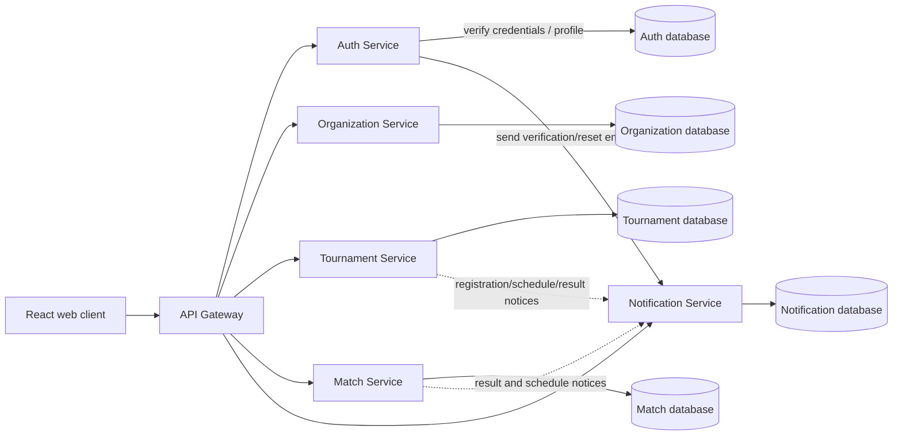
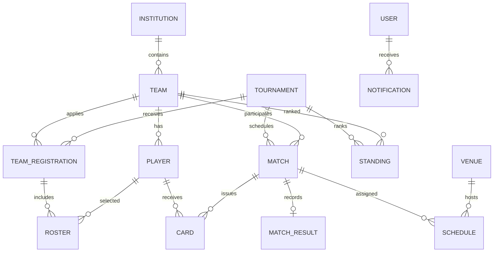

# Refactor map: eight legacy services to five target services

## Scope and guardrails

The target is five backend business services. `api-gateway` and `web-client` remain edge/client applications and are not counted as business services. Keep legacy source and databases until the target endpoint and data migration have been verified. No cross-service database writes are allowed after cutover; relationships between service-owned entities are IDs validated via API or events.

This workspace has no Git metadata. Work is proceeding in place at the user's direction. Code has been consolidated into exactly five backend service directories; existing database volumes and records have not been deleted.

## Service mapping and database ownership

| Target | Legacy source | Tables/data to own after migration |
|---|---|---|
| Auth | `auth-service` + `user-service` | From `sfl_auth`: `email_verifications`, `email_verification_rate_limits`, `refresh_tokens`; from `sfl_user`: `users`, `user_roles`, `password_resets`. Redis sessions remain an auth concern until the auth/session design changes. |
| Organization | `team-service` | From `sfl_team`: `institutions`, `institution_audit_logs`, `teams`, `players`. Team membership and representative data are currently modeled in `players`/`teams`; confirm semantics before changing schema. |
| Tournament | `tournament-service` plus registration/participant workflows from `team-service` | From `sfl_tournament`: `tournaments`, `seasons`, `registration_periods`, `regulation_versions`, `groups`, `draws`, `regulations`; move `team_registrations` and `rosters` from `sfl_team`. These tables reference team/player IDs logically, not by cross-database foreign keys. |
| Match | `match-service` + `scheduling-service` + `discipline-service` | From `sfl_match`: `matches`, `match_results`, `lineups`, `match_events`, `match_reports`, `standings`; from `sfl_scheduling`: `venues`, `venue_availability`, `schedules`; from `sfl_discipline`: `cards`, `suspensions`, `complaints`, `disciplinary_decisions`. |
| Notification | `notification-service` plus email-delivery module from `auth-service` | From `sfl_notification`: `notifications`, `delivery_logs`; move provider-independent email composition/delivery and delivery status handling out of Auth. Account workflows must call Notification synchronously or through a reliable outbox before reporting email success. |

### Legacy database inventory

The local PostgreSQL instance currently contains:

| Legacy database | Tables observed |
|---|---|
| `sfl_auth` | `email_verification_rate_limits`, `email_verifications`, `refresh_tokens` |
| `sfl_user` | `password_resets`, `user_roles`, `users` |
| `sfl_team` | `institution_audit_logs`, `institutions`, `player_requests`, `players`, `rosters`, `team_registrations`, `teams` |
| `sfl_tournament` | `draws`, `groups`, `registration_periods`, `regulation_versions`, `regulations`, `seasons`, `tournaments` |
| `sfl_match` | `lineups`, `match_events`, `match_reports`, `match_results`, `matches`, `standings` |
| `sfl_scheduling` | `schedules`, `venue_availability`, `venues` |
| `sfl_discipline` | `cards`, `complaints`, `disciplinary_decisions`, `suspensions` |
| `sfl_notification` | `delivery_logs`, `notifications` |

This inventory is specific to the local running database and is not a substitute for inspecting every deployment database before migration.

## Current API compatibility map

The frontend continues using `/api/...` paths. Gateway routing currently maps:

| Public API path | Current backend | Target backend |
|---|---|---|
| `/api/auth/**`, `/api/users/**` | Auth and User separately | Auth |
| `/api/institutions/**`, `/api/teams/**`, `/api/players/**`, `/api/player-requests/**` | Team | Organization |
| `/api/registrations/**`, `/api/rosters/**`, `/api/tournaments/{id}/registrations/**` | Team (some nested routes) | Tournament |
| `/api/tournaments/**`, `/api/seasons/**`, `/api/groups/**`, `/api/draws/**`, `/api/regulations/**` | Tournament | Tournament |
| `/api/matches/**`, `/api/lineups/**`, `/api/match-results/**`, `/api/match-events/**`, `/api/match-reports/**` | Match | Match |
| `/api/schedules/**`, `/api/venues/**`, `/api/venue-availability/**` | Scheduling | Match |
| `/api/cards/**`, `/api/suspensions/**`, `/api/complaints/**`, `/api/disciplinary-decisions/**` | Discipline | Match |
| `/api/notifications/**` | Notification | Notification |

Gateway session validation and service-level role/ownership checks must remain enforced during routing changes. Preserve response bodies, status codes, cookie behavior, and query/path shapes for existing frontend clients.

## Service interaction target

Solid arrows are synchronous API paths required for immediate responses. Dashed arrows are candidate notification events; they are not considered implemented until a reliable publisher, idempotent consumer, retry/dead-letter behavior, and integration tests exist. Do not add RabbitMQ as a label-only dependency.

## Database relationship map

The diagram expresses logical relations. Existing IDs cross database boundaries without foreign keys; future target migrations should preserve that rule and validate references through service APIs where correctness requires it.

## Safe implementation sequence

1. **Audit and compatibility:** record routes, schemas, API callers, data counts, role boundaries and backups. Keep existing databases writable only by their current owner while this step is active.
2. **Organization runtime boundary:** move the existing team runtime behind the Organization service name without changing data layout or API paths. Verify all forwarded identity headers and owner checks.
3. **Auth consolidation:** bring account/profile/password operations under Auth. Initially retain source databases and implement explicit migration/cutover; never let Auth and User concurrently write the same account records.
4. **Tournament registration ownership:** implement destination registration/roster schema and a repeatable copy/validation migration. Freeze writes or use a controlled dual-write/outbox strategy during cutover; compare counts and IDs before changing Gateway routes.
5. **Match consolidation:** merge scheduling and discipline modules with Match. Copy their data to the Match-owned database and validate match/schedule/referee/card relationships before route cutover.
6. **Notification ownership:** move provider integrations and email templates/delivery tracking; configure account workflows to fail explicitly or enqueue through a durable outbox.
7. **Five-service deployment:** only after each destination passes tests, update Compose/Gateway to use five application services. Keep old databases and deployment rollback procedure until post-cutover verification and backup restore rehearsal.

## Progress and verified changes

- Organization code now lives in `services/organization-service`; the API Gateway routes organization/team/player/institution paths to it. It continues using `sfl_team` without copying or deleting rows.
- Auth code now serves `/api/auth/**` and `/api/users/**`; the former User package is removed. Auth reads/writes preserved `sfl_auth` and `sfl_user` databases; no account rows were copied or deleted. Auth migration runner now upgrades both databases.
- Match code now serves match, schedule/venue/referee, and discipline endpoints. The former Scheduling and Discipline packages are removed; their source modules and schema migrations live under Match, which still uses their preserved databases.
- Auth delegates verification and reset email to Notification via a shared-key internal route. Notification owns SMTP selection, templates, and delivery logs; migration v2 adds `email_delivery_logs` without changing legacy rows.
- Compose has exactly five backend application runtimes and five target-owned one-shot migration jobs. `auth-migrate` covers `sfl_auth` and `sfl_user`; `match-migrate` covers `sfl_match`, `sfl_scheduling` and `sfl_discipline`. Migration jobs are not persistent application runtimes.
- Existing registration and roster endpoints still route to Organization and remain in `sfl_team`; moving them to Tournament is unfinished.
- No source database has been copied or deleted. Full SRS workflow verification and external SMTP verification are not complete.

## Release checks

- Compare source and destination row counts, primary keys, unique keys, and null/foreign-key-like reference violations for every moved table.
- Exercise registration, approval, roster finalization, schedule/referee assignment, match-result edit/cancel and standings recalculation using migrated records.
- Validate denied access for wrong roles and non-owner identities at both Gateway and service.
- Verify email provider acceptance/failure behavior; no successful API response may imply delivery acceptance if the provider rejected the message.
- Build and start the five target containers on a preserved copy of the current data; verify health, API compatibility, and backup restoration before deleting any old database.
